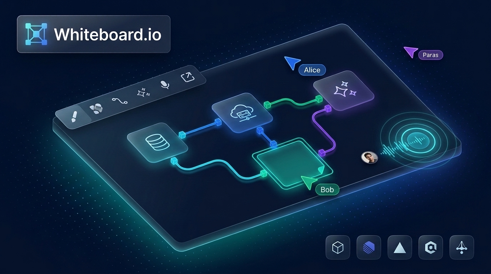

# 🎨 Whiteboard.io — Real-Time Collaborative Whiteboard

<div align="center">

[](https://whiteboard-io-1.onrender.com/)
[](LICENSE)
[](https://www.typescriptlang.org/)
[](https://react.dev/)
[](https://nodejs.org/)
[](https://socket.io/)
[](docs/ARCHITECTURE.md)

<br />

**A real-time distributed collaborative digital whiteboard with infinite canvas ergonomics, WebRTC P2P voice mesh, multi-provider AI diagram synthesis, element attribution & Blame Mode, and live multi-format export.**

[🌐 Explore the Live Application](https://whiteboard-io-1.onrender.com/) · [📖 Architecture](docs/ARCHITECTURE.md) · [📊 Presentation Deck](docs/Whiteboard_io_Presentation.pptx) · [📝 Speaker Script](docs/Whiteboard_io_Presentation_Script.docx) · [📄 Project Report](docs/report-tooling/Generated_Project_Report.docx) · [🐛 Report Issue](https://github.com/PARASMANI-KHUNTE/Whiteboard.io/issues)

<br />



</div>

---

> [!TIP]
> **Live Production Deployment**: Experience Whiteboard.io in real time at **[https://whiteboard-io-1.onrender.com/](https://whiteboard-io-1.onrender.com/)**. Open the link across multiple devices or browser windows to test real-time multiplayer drawing, Blame Mode attribution, WebRTC mesh voice chat, and multi-provider AI diagram synthesis.

---

## 💡 What is Whiteboard.io?

**Whiteboard.io** is an all-in-one collaborative visual workspace built for distributed engineering teams, product designers, educators, and technical creators.

Rather than treating a digital whiteboard as just a flat drawing canvas or a gated enterprise SaaS tool, Whiteboard.io combines **low-latency Canvas 2D + SVG collaboration**, **element-level author accountability**, **built-in WebRTC voice communication**, **switchable cloud/local AI diagramming**, and **offline-first solo continuity** in one self-hostable MIT-licensed platform.

---

## 🥊 Why Whiteboard.io? (How It Differs From Alternatives)

| Capability | Whiteboard.io | Miro | Excalidraw | FigJam | Google Jamboard |
| :--- | :---: | :---: | :---: | :---: | :---: |
| **Multi-Provider AI Diagrams** | ✅ **Built-In Switcher** (Gemini, Groq, NVIDIA NIM, OpenRouter, DeepSeek, Ollama, Procedural) | 💰 Paid Add-on | ⚠️ Limited / External Plugin | 💰 Paid / Credit Capped | ❌ Deprecated |
| **AI Failover Chain & Rate-Limit Shield** | ✅ **Automatic Failover** (404/503 circuit breaker, queue pacing, 2hr cache, procedural fallback) | ❌ Standard errors | ❌ N/A | ❌ Hard caps | ❌ No AI |
| **Interactive AI Follow-up Chat** | ✅ **In-Canvas Chat Drawer** (Conversational revisions + visual element diff highlights) | ❌ Static generation | ❌ None | ⚠️ Basic text | ❌ None |
| **Attribution, Blame Mode & Timeline** | ✅ **Built-In** (`createdBy`/`lastModifiedBy`, hover tooltips, Blame Mode, Activity Timeline) | 💰 Enterprise history | ❌ None | ⚠️ Cursor names only | ❌ None |
| **Built-in Peer-to-Peer Voice Mesh** | ✅ **Native WebRTC Audio** with live cursor speaking halos & waveform | 💰 Enterprise Only | ❌ Requires external call | ⚠️ Basic Audio | ❌ Requires Google Meet |
| **Consensus Vote-to-Clear & Governance** | ✅ **15s Democratic Vote** + Host lock, per-user write toggle, kick | ❌ Host wipe / undo | ❌ Anyone can clear | ❌ Anyone can clear | ❌ Anyone can clear |
| **Live Export Preview & Formats** | ✅ **PNG, SVG, JPEG, WEBP, JSON** (1x–3x scale, board/viewport, transparency) | ⚠️ Full features paid | ✅ PNG/SVG/JSON | ⚠️ Paid tiers | ⚠️ PDF/PNG only |
| **Offline Solo + Cross-Tab Merge** | ✅ **IndexedDB + BroadcastChannel Sync** + 1-click Go Live migration | ❌ Account required | ✅ LocalStorage | ❌ Online account | ❌ Online account |
| **Self-Hostable & Open Source** | ✅ **MIT License** (Render, Railway, VPS) | ❌ Proprietary SaaS | ⚠️ Client open / backend custom | ❌ Proprietary SaaS | ❌ Shut Down |

### Key Differentiators Explained

1. **⚡ Resilient Multi-Provider AI Engine**:
   Switch directly inside the AI Generate and AI Chat dialogs between **Google Gemini**, **Groq**, **NVIDIA NIM**, **OpenRouter**, **DeepSeek**, local **Ollama** (`llama3.2`), or `Auto` failover. A 5-layer shield — IP rate limiting, 2-hour response cache, outbound queue pacing, 404/503 circuit breakers, and an offline procedural fallback — ensures diagram generation never leaves users stuck.
2. **🕵️ Drawing Accountability ("Who Drew What?")**:
   Every stroke, sticky note, shape, text box, icon, and wire carries server-stamped `createdBy` and `lastModifiedBy` attribution persisted in MongoDB. Hover any element for an author tooltip, toggle **Blame Mode** to colorize the canvas by contributor with a live legend, or open the **Activity Timeline** drawer for a chronological feed with 1-click camera focus.
3. **🎙️ Built-In WebRTC P2P Voice Mesh**:
   Collaborate by voice directly inside the room over `RTCPeerConnection` mesh signaling — complete with `AudioContext` frequency waveform visualizers, animated speaking halos around remote cursors, mute/deafen controls, per-user volume, and custom STUN/TURN support.
4. **🛡️ Anti-Troll Governance & Vote-to-Clear**:
   Prevent accidental wipes with a democratic 15-second **Vote-to-Clear** consensus banner, host view-only room locking, per-participant write toggles, element locking, and multi-tab kick enforcement.
5. **💾 Offline-First Continuity**:
   Start drawing immediately in **Solo Mode** with automatic **IndexedDB** persistence (`localStorage` fallback), cross-tab **BroadcastChannel** conflict-merging, stable guest profiles, and **1-click migration** into a live collaborative room.

---

## 🚀 Key Features

* **✨ Multi-Provider AI Diagram & Mind Map Engine**:
  * In-app provider & model switcher across **Google Gemini** (`gemini-3.8-flash`), **Groq**, **NVIDIA NIM**, **OpenRouter**, **DeepSeek**, local **Ollama** (`llama3.2`), and offline **Procedural Synthesis**.
  * 4 layouts: 🧠 **Mind Maps**, 🔀 **Flowcharts**, 📋 **Sticky Boards**, and 🏗️ **System Architectures**.
  * Interactive **AI Chat Drawer** for conversational diagram edits with visual diff highlights and atomic undo/redo.
* **🕵️ Version & Author Attribution**:
  * **Server-Stamped Attribution**: Tracks `createdBy`, `createdAt`, `lastModifiedBy`, and `lastModifiedAt` across all element types and board clears.
  * **Hover Tooltips & Blame Mode**: 200ms hover tooltips on any element plus a toggleable **Blame Mode** overlay with creator badges and legend counts.
  * **Live Activity Timeline**: Chronological room feed with 10s edit coalescing and click-to-focus camera navigation.
* **🎨 High-Performance Infinite Canvas**:
  * **HTML5 Canvas 2D + SVG Hybrid Engine** with 256px **2D Spatial Indexing** ($O(\log N + K)$ culling/hit-tests), **Ramer-Douglas-Peucker** stroke simplification, and 50ms drag-update coalescing.
  * **Pro Ergonomics**: Smart edge/center **Alignment Guides**, optional **24px Grid Snap** (`Alt` bypass), collapsible **Floating Quick-Tool Dock**, **Empty-Canvas Quick-Start Guide**, **Fit-to-Screen** (`Shift+1`), collapsible **Canvas Minimap**, and **Click-to-Follow Collaborator** cursors.
* **📐 Complete Creative Toolset**:
  * Freehand Pen & Highlighter, Eraser, **Resizable Sticky Notes** (4-corner handles & color swatches), Rich Text formatting, Shapes (Rectangle, Circle, Diamond, Triangle, Star, Arrow) with rotation & opacity, searchable Lucide Icon Library, and magnetic anchor-snapping Bézier/Line **Wire Connectors**.
* **⌨️ Power Productivity & Export**:
  * **`Ctrl+K` / `Cmd+K` Command Palette**: Fuzzy-searchable launcher across all tools and workspace actions.
  * **Live Preview Multi-Format Exporter (`Ctrl+Shift+E`)**: Export **PNG**, **SVG**, **JPEG**, **WEBP**, or **JSON** with `1x–3x` scale, `Board` vs `Viewport` scope, light/dark/checkerboard transparency preview, and clipboard copy.
* **🔐 Authentication & Governance**:
  * Email/password auth (`PBKDF2-SHA512`, 100k iterations), **Google OAuth 2.0** (nonce/state binding), and 7-day TTL **Guest** sessions.
  * Host lock, per-user write permissions, user kick, automatic host handoff, and Vote-to-Clear.

---

## 🛠️ Technology Stack

| Layer | Technologies |
| :--- | :--- |
| **Frontend** | React 19, TypeScript (~5.8), Vite 6, Tailwind CSS 4, `motion`, Lucide Icons |
| **Canvas Engine** | HTML5 Canvas 2D + SVG, 2D Spatial Index, Web Audio API (`AnalyserNode`) |
| **Artificial Intelligence** | Google Gemini, Groq, NVIDIA NIM, OpenRouter, DeepSeek, Local Ollama (`llama3.2`), Procedural Layout Engine |
| **Real-Time & Voice** | Socket.io Client/Server 4.8, WebRTC `RTCPeerConnection` (P2P Audio Mesh) |
| **Backend** | Node.js (ESM, >=20.19), Express 4, `esbuild` |
| **Database & Storage** | MongoDB 7 Native Driver (required on server), IndexedDB + `BroadcastChannel` (client solo mode) |
| **Security** | PBKDF2-SHA512 (100k iterations), 32-byte Opaque Bearer Tokens, OAuth Nonce/State CSRF Binding, Rate Limiting, Strict Payload Allowlists |
| **Quality & CI/CD** | GitHub Actions CI (`tsc --noEmit`, 222 `tsx --test` assertions, Vite/`esbuild` production builds, Python report freshness & secret scans), Render |

---

## 📚 In-Depth Project Documentation

* 🏛️ **[System Architecture & Data Flow](docs/ARCHITECTURE.md)**: Real-time event pipeline, state conflict resolution, debounced persistence, spatial indexing, and MongoDB schemas.
* 📡 **[REST API & Socket.io Events Reference](docs/API_AND_EVENTS.md)**: Full specification of REST endpoints and Socket.io emitter/listener protocols.
* 💻 **[Client Architecture & Component Guide](docs/CLIENT_GUIDE.md)**: React component hierarchy, custom hooks, canvas geometry/rendering math, and persistence utilities.
* 🚢 **[Deployment & Cloud Hosting Guide](docs/DEPLOYMENT_GUIDE.md)**: Render, Vercel, Google OAuth setup, and MongoDB Atlas guide.
* 📊 **[Project Presentation Deck](docs/Whiteboard_io_Presentation.pptx)** & **[Speaker Script](docs/Whiteboard_io_Presentation_Script.docx)**: 11-slide visual overview and companion walkthrough script.

---

## ⚡ Quick Start (Local Development)

### Prerequisites
* **Node.js**: v20.19.0 or higher (22 LTS recommended — the MongoDB 7 driver requires `>=20.19`)
* **npm**: v10.0.0 or higher
* **MongoDB (required)**: A running local MongoDB instance (`mongodb://127.0.0.1:27017`) or a [MongoDB Atlas](https://www.mongodb.com/atlas) connection string. The server connects at startup and will not listen without a reachable MongoDB.

### 1. Clone, Build & Verify
```bash
git clone https://github.com/PARASMANI-KHUNTE/Whiteboard.io.git
cd Whiteboard.io

# Install client and server dependencies & build bundles
npm run build

# Run the full verification suite used by CI
npm run typecheck
npm test
npm run secret:scan
```

### 2. Configure Environment Variables

**Server Environment** (`server/.env`):
```env
PORT=3000
APP_URL=http://localhost:5173
MONGODB_URI=mongodb://127.0.0.1:27017/whiteboard

# AI engine: "auto", "gemini", "groq", "nvidia", "openrouter", "deepseek", "ollama", or "fallback".
AI_PROVIDER=

# Google Gemini API Key for AI Diagram & Mind Map Generation
GEMINI_API_KEY=your_gemini_api_key_here
GEMINI_MODEL=gemini-3.8-flash
GEMINI_FALLBACK_MODELS=gemini-flash-lite-latest,gemini-3.6-flash

# Optional additional OpenAI-compatible AI providers (selectable in-app)
GROQ_API_KEY=
GROQ_BASE_URL=https://api.groq.com/openai/v1
NVIDIA_API_KEY=
NVIDIA_BASE_URL=https://integrate.api.nvidia.com/v1
OPENROUTER_API_KEY=
OPENROUTER_BASE_URL=https://openrouter.ai/api/v1
DEEPSEEK_API_KEY=
DEEPSEEK_BASE_URL=https://api.deepseek.com

# Local Ollama engine (no API key needed)
AI_ALLOW_OLLAMA_FALLBACK=true
OLLAMA_BASE_URL=http://127.0.0.1:11434
OLLAMA_MODEL=llama3.2

# Optional Google OAuth Credentials
GOOGLE_CLIENT_ID=
GOOGLE_CLIENT_SECRET=
```

#### Local AI with Ollama (optional)

Install [Ollama](https://ollama.com), pull a model, and set `AI_PROVIDER=ollama`:

```bash
ollama pull llama3.2
ollama serve
```

| Model | Size | Notes |
| :--- | :---: | :--- |
| `llama3.2` | ~2 GB | Default. Fast and reliably emits schema-constrained JSON. |
| `qwen2.5-coder:14b` | ~9 GB | Stronger structure/labels if you have the VRAM. |
| `qwen2.5:7b-instruct` | ~4.7 GB | Good reasoning; test quantized builds under JSON constraints. |

Tuning variables (`OLLAMA_TIMEOUT_MS`, `OLLAMA_NUM_CTX`, `OLLAMA_NUM_PREDICT`, `OLLAMA_KEEP_ALIVE`, `OLLAMA_MIN_INTERVAL_MS`, `OLLAMA_API_KEY`) are documented in `server/.env.example`.

**Client Environment** (`client/.env`):
```env
# Leave empty in local dev to use Vite's built-in dev proxy
VITE_BACKEND_URL=http://127.0.0.1:3000
```

### 3. Run the Development Servers
```bash
# Terminal 1: Backend Server (http://localhost:3000)
cd server
npm run dev

# Terminal 2: Frontend Client (http://localhost:5173)
cd client
npm run dev
```

Open [http://localhost:5173](http://localhost:5173) in your browser and open another tab or incognito window to test live multiplayer collaboration.

---

## 🌐 Production Deployment Summary

### Option A: Full-Stack Web Service (Recommended)
Deploying on **Render**, **Railway**, or a single VPS:
1. Create a **Web Service** with **Node** runtime (`>=20.19`).
2. **Build Command**: `npm run build`
3. **Start Command**: `npm start`
4. Set environment variables (`APP_URL`, `MONGODB_URI`, configured AI API keys, and optional `GOOGLE_CLIENT_ID` / `GOOGLE_CLIENT_SECRET`).

### Option B: Split Frontend (Static) & Backend (Web Service)
* **Backend**: Node Web Service with `APP_URL` pointing to your frontend origin (for CORS & OAuth redirects).
* **Frontend**: Static site publishing `client/dist` with `VITE_BACKEND_URL` pointing to the backend URL.

---

## ⌨️ Keyboard Shortcuts Reference

| Key | Tool / Action | Key | Tool / Action |
| :---: | :--- | :---: | :--- |
| `V` | Select / Move | `S` | Sticky Note |
| `H` | Hand / Pan | `T` | Text Box |
| `P` | Freehand Pen | `R` | Shapes |
| `Y` | Highlighter | `I` | Icon Library |
| `E` | Eraser | `W` | Wire Connector |
| `Ctrl + K` / `Cmd + K` | **Command Palette** | `Ctrl + Shift + E` | **Export & Preview** |
| `Shift + 1` | **Fit All to Screen** | `0` / `+` / `-` | Reset / Zoom In / Out |
| `Space + Drag` / `Middle` | Pan Canvas | `Ctrl + Wheel` | Zoom to Cursor |
| `Ctrl + Z` / `Ctrl + Shift + Z` | Undo / Redo | `Ctrl + A` | Select All |
| `Ctrl + C` / `Ctrl + X` / `Ctrl + V` | Copy / Cut / Paste | `Ctrl + D` / `Alt + Drag` | Duplicate |
| `Delete` / `Backspace` | Delete Selection | `[` / `]` | Send Backward / Bring Forward |
| `Arrow Keys` / `Shift + Arrow` | Nudge 1px / 10px | `?` or `Shift + /` | Shortcut Cheat Sheet |
| `Esc` | Clear Selection / Close Overlay | `Right Click` | Context Menu |

---

## 📄 License

This project is licensed under the [MIT License](LICENSE).
